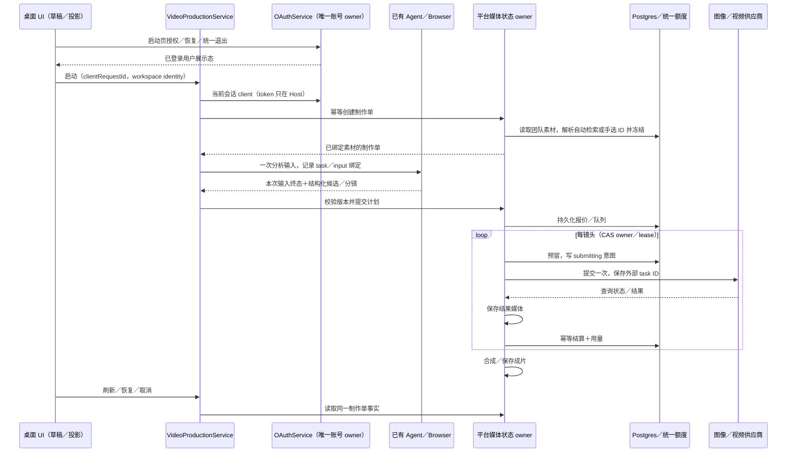

# 桌面商品视频生产契约

日期：2026-10-20。状态：已实现，真实网站与付费供应商联调待验收。替代 2026-10-16 历史方案的产品流程；供应商和价格以后台实际配置为准。

## 产品规则

- 桌面侧栏提供「视频创作」。一键生成从团队图片资产检索，Agent 在现有内置浏览器搜索抖音／小红书；链接复刻接受分享文本中的 HTTP(S) 视频页面链接。两者共用制作单。
- 默认无需手动勾选图片：创建请求的 `assetIds: []` 表示由平台按商品名称检索当前认证团队的图片。完整商品标签匹配优先，其次商品标签／文件名包含完整查询；只使用最佳匹配级别，按创建时间降序、ID 升序最多取 20 张。查询忽略大小写和首尾空格；不匹配其他团队、视频或无关图片。没有结果返回 `product_assets_not_found`，用户可上传或手动指定图片。显式非空 assetIds 保持用户选择。
- 平台在首次创建时解析并冻结非空资产 ID；同 requestId 重试读取既有绑定，不因团队后来上传素材而改变。Agent 只接收冻结后的素材，制作详情展示实际采用图片。Renderer 不维护自动匹配事实或另行实现检索算法。
- 用户一次选择素材、商品／卖点、模型、分辨率、比例、目标时长与消费上限后启动。分镜审阅可选；默认分析完成自动提交生成，不逐镜头强制确认。
- 排名只描述当前账号本次可见候选。保留来源 URL、采集时间、可见互动数据、选择原因；不得声称全平台最高。不能访问、需要登录或未观察到视频画面时明确失败／等待，不编造镜头分析。
- 分镜包含来源时间范围、景别、运动、动作、营销目的、生成提示、商品资产绑定、字幕与时长。所有画面由已配置模型生成，最终按顺序拼接多个片段，不用静态图运动冒充模型生成。
- 分辨率／时长只选后台模型支持范围。1 credit = ¥1；整数 micro-credit 计量。后台报价、冻结与结算为事实；用户上限不等于报价；文字 Agent 推理独立通过现有网关计费，界面明确视频报价范围。
- 团队共享上传素材、制作单与成片。首版使用平台持久化媒体目录和有时效签名 URL，生产须挂载持久卷；不把供应商临时链接视为保存成功。
- 未配置平台、未登录、无团队、无视频模型／价格、合成依赖缺失时返回具体错误，禁止伪成功或用演示结果替代真实生成。

## 状态归属和边界

平台 Go media 服务唯一拥有制作单、分镜、供应商 task ID、费用、取消与成片状态；Postgres 是持久化事实，memory 模式同语义仅用于测试。资金复用 PlatformStore 的预留与结算。每个镜头尝试独立 requestId／reservationId，成功镜头在恢复时复用。视频预留由任务持有，通用 TTL sweeper 不得释放仍运行媒体预留。

应用 Host OAuthService 唯一拥有平台账号会话；启动页「登录门道」通过已有 startOAuthWithPolling／pollPendingOAuth 完成平台设备授权，以 `mendao` provider 保存同一加密会话和用户缓存，Root 沿用同一恢复／取消／登出流程。VideoProductionService 仅依赖 Host 内部已认证平台 client 和本地分析绑定，不拥有第二套登录凭据，不暴露 configure／login／logout RPC。视频页已登录直接加载素材和制作记录；跳过首登或授权过期时只引导统一登录入口，不要求填写 API 地址。平台 origin 由部署配置 `MENDAO_PLATFORM_API_ORIGIN` 提供（默认 `https://api.mendao.chat`），运行中不允许页面切换。

账号能力不以视频功能开关为前提；所有应用 Host 使用同一授权入口，媒体操作仍限本地桌面。已恢复账号即满足启动登录门禁，不因未选择旧 ZAI／BigModel 运行域再次要求登录；这不表示模型配置已经可用。视频首次读取连接状态时显示加载态，避免已登录用户短暂看到二次登录提示。授权被拒绝或到期必须进入可取消／重试的失败态，不能永久等待。账号切换前与登出时在会话串行队列内先清理媒体 gateway／广播退出，再允许新会话写入，避免旧退出通知清理新账号。

旧视频专用凭据在统一登录服务中一次迁移：仅在当前没有 app 会话、旧地址严格等于当前部署平台、且 token 经平台返回用户校验后迁移；失败不静默冒用。迁移成功／统一登出清理旧键。其他 provider 凭据不发送给平台。Renderer 通过 RPC／hook 提交操作并展示远端投影，不直接读写账本、供应商或文件。Main 继续只负责原生操作和浏览器桥。

分析复用 IMendaoTaskService，保留 workspaceIdentity、workspacePath 和已有 owner／lease。不增加 CLI 协议或第二个 Agent。Agent 输出严格 JSON 分镜，Host 仅在本次输入终态后验证并提交；重启可读取会话快照恢复。分析重试显式发起，旧 task 结果不能覆盖新的绑定。CLI 明确返回 sendText rejected／stale ACK 时结束本次分析并允许重新分析；网络断开等未知 admission 结果仍保留绑定恢复，不盲目重发。专属分析会话恢复时读取完整消息，不能截掉首条输入标记；浏览器多步工具产生超过 10 条消息仍可提交最终分镜。原会话允许用户补充登录／继续指令，首条输入必须匹配本次绑定且后续不能出现另一个制作单标记；只接受最后一条用户输入之后已完成的最终回复，不能用旧计划覆盖新输入。

平台请求由 OAuthService 的会话代次隔离：统一退出／更换账号使旧操作失效，凭据写入和清理复用 session mutation queue；HTTP 响应和 JSON 解析后再次校验代次。401 仅在当前 token 仍匹配时清理会话并通知 Root，不清理新登录。分析跨 overview、文字配置、gateway 写入、task 创建、绑定和派发的每一步均校验同一代次。gateway 配置与清理串行，统一退出后旧配置不能复活；已被平台受理的远端操作仍由平台幂等状态负责恢复。

未知提交结果标记 reconciliation_required，不自动再次提交付费任务。明确供应商失败可显式重试，仅重试失败片段；提交后取消停止新镜头，已有供应商任务继续查询并按实际成功结算，不能先释放再晚到扣款。合成失败保留成功镜头，可重试合成。资产／制作单按认证团队隔离；签名 URL 时效校验；所有外部下载由受控 HTTP adapter 执行，禁止私网 SSRF 和密钥跨源转发。

Desktop continuous 与手机 replayable 仍使用现有同一 Agent owner；媒体页不重放 Agent 输入，不新增手机 Agent。首版媒体启动只在本地桌面开放，其他端明确能力不可用。

## 接口

RPC `video-production`：只读连接状态、overview、资产上传、创建／分析制作单、获取／取消／重试／确认生成、导出成片。认证复用 `oauth` RPC；凭据不进入 prompt、日志或 UI 状态。

平台 `/api/v1/media`：overview、assets 上传／读取、projects 创建／列表／详情／分析绑定／计划提交／生成／取消／重试。设备 Bearer 认证；团队来自服务端 ResolveUserTeam，不信任 body teamId。Console root 管理媒体模型配置，复用已加密供应商。跨仓 wire schema 保持同构。

平台 `GET /api/v1/platform/account`：同一设备 Bearer 校验，仅返回当前账号 id／email／display_name，不要求已建立团队，用于应用缓存迁移和显式会话校验；无效或吊销凭据返回 401。

## 验收场景

1. 一键／复刻入口切换，分享链接提取与去重，必填／非法链接／消费上限校验。
2. 首屏统一授权一次后视频页无需再次登录；暂时跳过则引导统一入口。拒绝／过期／401、无团队、缺模型均明确展示；统一登出清除授权、视频投影与 gateway，迟到响应不能恢复旧账号内容。
3. 上传团队图片后可检索复用，其他团队不可访问；大文件／非图片输入拒绝。
4. Agent 保留浏览器证据输出真实分镜；非法 JSON、不足证据不进入生成；输入失败可打开原会话处理登录／权限。
5. 双击／网络重发同 requestId 不重复任务；陈旧分析不能覆写；客户端关闭后恢复平台任务。
6. 多镜头逐一生成并拼接；结果已持久化才交付；分镜／阶段／报价／实际用量可见。
7. 余额不足不调用供应商；重试不重复计费；未知付费提交不自动重发；长任务预留不被 TTL 回收。
8. 部分镜头失败、下载失败、合成失败、取消及晚到成功可恢复，成功片段复用。
9. UI 覆盖深浅主题、键盘、窄窗口；桌面 E2E 使用本地受控 fixture，不产生真实付费请求。
10. 不勾选图片即可提交自动检索；同商品标签与文件名回退、匹配上限、团队隔离、空结果提示、手动覆盖及创建重试冻结均有回归证据。

## 恢复与部署细则

- 合成必须具备 ffmpeg、ffprobe、libx264、AAC 和 libass subtitles 滤镜；启动生成前检查，缺失时不提交付费调用。字幕烧录到成片，保留已有模型音轨，无音轨补静音。视频按请求的镜头秒数零售计费，成功落盘后幂等结算；不使用供应商 token 推算视频费用。
- 图片与视频生成返回 URL 后先持久化，再下载；下载重试直接复用 URL，不再次生成或依赖供应商查询接口可用。取消在供应商提交前释放预留，在提交后等待明确结果。已成功片段不退款且不重生成；合成完成时重新读取取消标记。
- 未知提交只允许 root 在控制台核对：补录已受理 video task ID、补录 image result URL，或确认供应商未受理并释放该次预留。每次核对必须有原因、版本校验和独占 lease，记录审计。普通用户不能补录供应商结果。
- 团队模型白名单同时适用于媒体模型。设备登录支持独立 API 与网页域名；Agent 分析只选择平台下发的文字模型，通过现有 Provider 配置仓储合并 platform:gateway，不覆盖其他 Provider。

## 播放与恢复补充

UI 的视频播放源属于本地展示状态。overview 每 5 秒轮询，新的签名 URL 不应重置同一资产的播放器；只在资产或源地址变化、旧签名不足 2 分钟有效期时换源。导出仍使用平台最新签名 URL。视频 running → video_ready（持久化 URL）→ video_saved → succeeded 的事件顺序必须可恢复；旧数据 video_ready 未保存 URL 时仅查询原 task 补齐，不新建任务。

导出在 Host 通过最新同源签名 URL 流式下载，不转发设备 Authorization；先写随机临时文件，再以不覆盖已有文件的方式交付。流中断时清理临时文件；重复导出不能覆盖用户已有成片。
